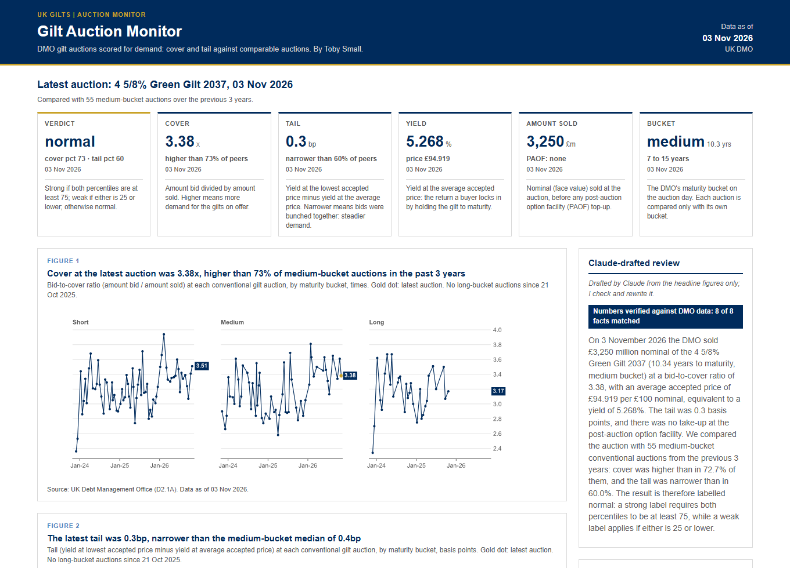

# Gilt Auction Monitor

Scores every UK government bond (gilt) auction since 1998 for investor demand: how much was bid (cover) and how tightly the bids were priced (tail), compared with similar auctions over the previous three years.
It builds a one-page website with charts, a longer-run comparison and an optional Claude-drafted review of the latest auction.

[](https://tbysmll.github.io/gilt-auction-monitor/)

**Live site:** [https://tbysmll.github.io/gilt-auction-monitor/](https://tbysmll.github.io/gilt-auction-monitor/) · data as of 03 Nov 2026

## Quick start

You need [Python](https://www.python.org/downloads/) 3.12 or later and [Git](https://git-scm.com/). On a Mac or Linux, type `python3` where it says `python`.

```
git clone https://github.com/tbysmll/gilt-auction-monitor.git
cd gilt-auction-monitor
python -m venv .venv
.venv\Scripts\activate            # Windows
source .venv/bin/activate         # Mac or Linux
pip install -r requirements.txt
python main.py --sample           # try it with the bundled data: nothing is downloaded
python main.py                    # live data: downloads the latest DMO reports
```

Then open `docs/index.html` in your browser. Each run also writes `output/summary.md` (a record of the run) and `output/comparison.md` (the longer-run table).

## If the download is blocked

The DMO's website has bot protection, so it often refuses automatic downloads. When that happens, `python main.py` lists exactly which files to download by hand and carries on with the newest copies already saved. The tool needs these three reports:

| Report | Code | Download page | Save in |
|---|---|---|---|
| Outright Gilt Auctions | D2.1A | [https://www.dmo.gov.uk/data/ExportReport?reportCode=D2.1A](https://www.dmo.gov.uk/data/ExportReport?reportCode=D2.1A) | `data/` |
| Gilts in Issue | D1A | [https://www.dmo.gov.uk/data/ExportReport?reportCode=D1A](https://www.dmo.gov.uk/data/ExportReport?reportCode=D1A) | `data/maturities/` |
| Redemption Details of Redeemed Gilts | D1C | [https://www.dmo.gov.uk/data/ExportReport?reportCode=D1C](https://www.dmo.gov.uk/data/ExportReport?reportCode=D1C) | `data/maturities/` |

Open each page, export the report as Excel, and save the file in the folder shown. The file name doesn't matter: each file is recognised by the title inside it. Then run `python main.py --offline` to use them without trying the download again.

## Command-line options

| Option | What it does | Example |
|---|---|---|
| *(none)* | Downloads the data, scores every auction, draws the charts and writes the website, summary and README. No Claude needed. | `python main.py` |
| `--sample` | Uses the copies of the three reports in `sample_data/` (data as of 03 Nov 2026) instead of downloading. | `python main.py --sample` |
| `--offline` | Skips the download and uses the reports already saved in `data/`. | `python main.py --offline` |
| `--review` | Also asks Claude to draft a short review of the latest auction, then checks every auction fact it quotes against the data. Needs [Claude Code](https://claude.com/claude-code) installed and logged in; without it, the run carries on with no review. | `python main.py --review` |
| `--compare` | Compares any two periods (default 2015-2021 and 2023-2025). Each period needs at least 10 auctions. | `python main.py --compare 2010-2014 2023-2025` |
| `--bucket` | Limits the comparison to one maturity bucket: `short`, `medium`, `long` or `all` (default). | `python main.py --compare 2010-2014 2023-2025 --bucket long` |

Options can be combined, e.g. `python main.py --offline --review`. `python main.py --help` lists them all. `--compare` and `--bucket` change the printed table and `output/comparison.md`; the website always shows the standard comparison below.

## How the scoring works

When the government borrows, the DMO auctions gilts to investors. Two numbers from each auction show how keen investors were:

- **Cover** (the bid-to-cover ratio) is the amount bid divided by the amount sold. A cover of 3 means £3 was bid for every £1 of gilts on offer. Higher means more demand.
- **Tail** is how far the weakest accepted bid was from the average one, measured in yield: the yield at the lowest accepted price minus the yield at the average accepted price, in basis points (1bp = 0.01%). A narrow tail means bidders agreed on the price; a wide one means some only bought at a discount.

Each auction is then compared with others like it:

1. **Same maturity.** Gilts are grouped by years left until they're repaid, using the DMO's buckets: short (under 7 years), medium (7 to 15) and long (over 15). Index-linked gilts are left out: every winning bidder pays the same price, so there's no tail.
2. **Same recent period.** An auction's peers are the auctions in its bucket over the previous 3 years (at least 10 are needed to score it).
3. **Percentiles.** The cover percentile is the share of peers with a lower cover; the tail percentile is the share with a wider tail. Ties count as half. For both, higher is better.
4. **One rule for the label.** *Strong* if both percentiles are at least 75; *weak* if either is 25 or lower; otherwise *normal*. One bad measure is enough to call an auction weak.

## Longer-run view

Conventional auctions in 2015-21 compared with 2023-25:

| Group | Period | Auctions | Median cover (x) | Median tail (bp) | Median yield (%) |
|---|---|---|---|---|---|
| All conventional | 2015-21 | 337 | 2.24 | 0.3 | 0.83 |
| All conventional | 2023-25 | 171 | 2.98 | 0.5 | 4.31 |
| short | 2015-21 | 115 | 2.28 | 0.3 | 0.37 |
| short | 2023-25 | 68 | 3.04 | 0.5 | 4.10 |
| medium | 2015-21 | 102 | 2.33 | 0.2 | 0.88 |
| medium | 2023-25 | 59 | 2.92 | 0.6 | 4.33 |
| long | 2015-21 | 120 | 2.16 | 0.3 | 1.27 |
| long | 2023-25 | 44 | 3.02 | 0.4 | 4.61 |

Across all conventional auctions, median cover rose from 2.24x in 2015-21 to 2.98x in 2023-25; the median tail widened from 0.3bp in 2015-21 to 0.5bp in 2023-25; and the median yield at the average accepted price rose from 0.83% in 2015-21 to 4.31% in 2023-25.

Each period runs from January of its first year to December of its last. Medians are the middle value, so a single unusual auction can't move them much. Try other periods with `--compare`.

## Data source

All data comes from the [UK Debt Management Office (DMO)](https://www.dmo.gov.uk/data/): the auction results are series **D2.1A**, [Outright Gilt Auctions](https://www.dmo.gov.uk/data/ExportReport?reportCode=D2.1A), and the redemption dates come from **D1A** (Gilts in Issue) and **D1C** (Redemption Details of Redeemed Gilts). `sample_data/` holds unchanged copies of the three reports as of 03 Nov 2026. The code is MIT licensed (see `LICENSE`); that licence covers the code only, not the DMO's data.

## Built by Toby Small

Built by **Toby Small**. Suggestions and bug reports are welcome as [GitHub issues](https://github.com/tbysmll/gilt-auction-monitor/issues).

**Make your own copy:** click **Use this template** at the top of the GitHub page, then put your own name and links in `config.py`.

*For learning purposes; not investment advice.*
