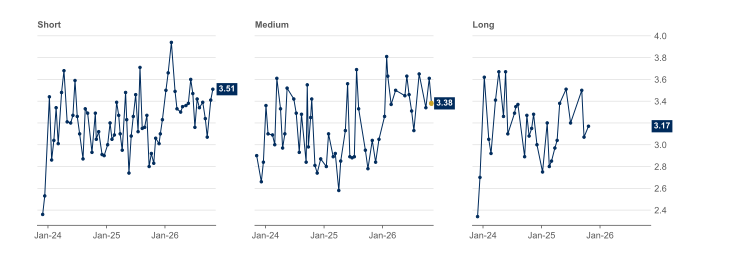
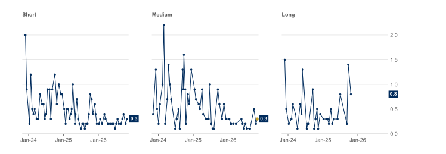
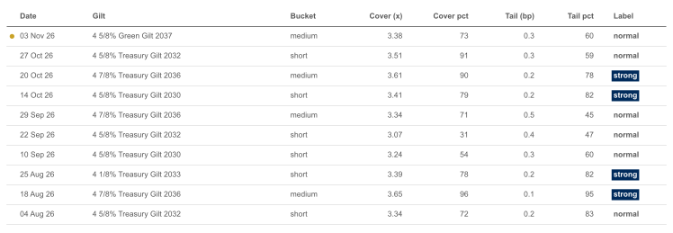

# Gilt Auction Monitor: run summary

Data as of 03 Nov 2026.

## Latest auction

| Fact | Value |
|---|---|
| Auction date | 3 November 2026 |
| Gilt | 4 5/8% Green Gilt 2037 |
| Years to maturity | 10.34 |
| Maturity bucket | medium (7 to 15 years) |
| Amount sold at auction (£ million nominal) | 3,250 |
| Post-auction option facility (PAOF) take-up (£ million nominal) | none |
| Bid-to-cover ratio | 3.38 |
| Average accepted price (£ per £100 nominal) | 94.919 |
| Yield at average accepted price (%) | 5.268 |
| Tail (basis points) | 0.3 |
| Peer auctions | 55 |
| Peer group | medium-bucket conventional auctions in the previous 3 years |
| Cover percentile | 72.7 |
| Tail percentile | 60.0 |
| Label | normal |
| Label rule | strong if both percentiles are at least 75; weak if either is 25 or lower; otherwise normal |

## Claude-drafted review

> The DMO's auction of the 4 5/8% Green Gilt 2037 on 3 November 2026 sold £3,250 million nominal of the medium-bucket bond, which has 10.34 years to maturity, at an average accepted price of £94.919 per £100 nominal, equivalent to a yield of 5.268%. The bid-to-cover ratio was 3.38, meaning cover was higher than in 72.7% of the 55 peer auctions, defined as medium-bucket conventional auctions in the previous 3 years. The tail was 0.3 basis points, narrower than in 60.0% of that peer group, indicating that accepted bids were relatively closely clustered around the average price. Taken together, both measures sit above the middle of the historical range but short of the 75th percentile threshold for a strong result, so the auction is classified as normal under our rule. There was no take-up at the post-auction option facility.

Numbers verified against DMO data: 8 of 8 facts matched.

| Number in draft | Fact | Check |
|---|---|---|
| 3,250 | Amount sold at auction (£ million nominal) | exact |
| 94.919 | Average accepted price (£ per £100 nominal) | exact |
| 5.268 | Yield at average accepted price (%) | exact |
| 3.38 | Bid-to-cover ratio | exact |
| 72.7 | Cover percentile | exact |
| 55 | Peer auctions | exact |
| 0.3 | Tail (basis points) | exact |
| 60.0 | Tail percentile | exact |

## Cover check (amount bid / amount sold, against the DMO's stated cover)

| Auction Date | Gilt Name | Amount Bid (£m) | Amount Sold (£m) | Recalculated Cover | DMO Cover | Result |
|---|---|---|---|---|---|---|
| 2026-11-03 | 4 5/8% Green Gilt 2037 | 10980.5 | 3250.0 | 3.3786 | 3.38 | matches |

## Charts

**1. Cover at the latest auction was 3.38x, higher than 73% of medium-bucket auctions in the past 3 years**

Bid-to-cover ratio (amount bid / amount sold) at each conventional gilt auction, by maturity bucket, times. Gold dot: latest auction. No long-bucket auctions since 21 Oct 2025. Source: UK Debt Management Office (D2.1A). Data as of 03 Nov 2026.

**2. The latest tail was 0.3bp, narrower than the medium-bucket median of 0.4bp**

Tail (yield at lowest accepted price minus yield at average accepted price) at each conventional gilt auction, by maturity bucket, basis points. Gold dot: latest auction. No long-bucket auctions since 21 Oct 2025. Source: UK Debt Management Office (D2.1A). Data as of 03 Nov 2026.

**3. Of the last 10 auctions, 4 scored strong, 6 normal and 0 weak**

Percentiles against auctions in the same bucket over the previous 3 years (higher = better). Strong: both at least 75. Weak: either 25 or lower. Source: UK Debt Management Office (D2.1A). Data as of 03 Nov 2026.

## Longer-run view

Across all conventional auctions, median cover rose from 2.24x in 2015-21 to 2.98x in 2023-25; the median tail widened from 0.3bp in 2015-21 to 0.5bp in 2023-25; and the median yield at the average accepted price rose from 0.83% in 2015-21 to 4.31% in 2023-25.

| Group | Period | Auctions | Median cover (x) | Median tail (bp) | Median yield (%) |
|---|---|---|---|---|---|
| All conventional | 2015-21 | 337 | 2.24 | 0.3 | 0.83 |
| All conventional | 2023-25 | 171 | 2.98 | 0.5 | 4.31 |
| short | 2015-21 | 115 | 2.28 | 0.3 | 0.37 |
| short | 2023-25 | 68 | 3.04 | 0.5 | 4.10 |
| medium | 2015-21 | 102 | 2.33 | 0.2 | 0.88 |
| medium | 2023-25 | 59 | 2.92 | 0.6 | 4.33 |
| long | 2015-21 | 120 | 2.16 | 0.3 | 1.27 |
| long | 2023-25 | 44 | 3.02 | 0.4 | 4.61 |
